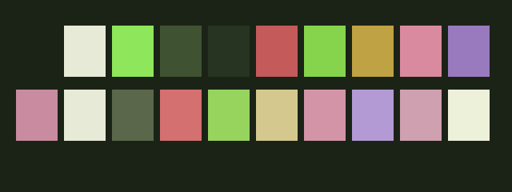

# Kokedera Spring

Dark flavor. Copy this folder into your Yazi configuration's `flavors/` directory and select `kokedera-spring` in `theme.toml`. See the repository README.

Palette preview: background, foreground, cursor, selection, then ANSI colors 0–15, read left to right across two rows. This illustrates the shared colors; it is not an application screenshot.

Flavor and matching TextMate theme: MIT, see [LICENSE](LICENSE) and [LICENSE-tmtheme](LICENSE-tmtheme).
