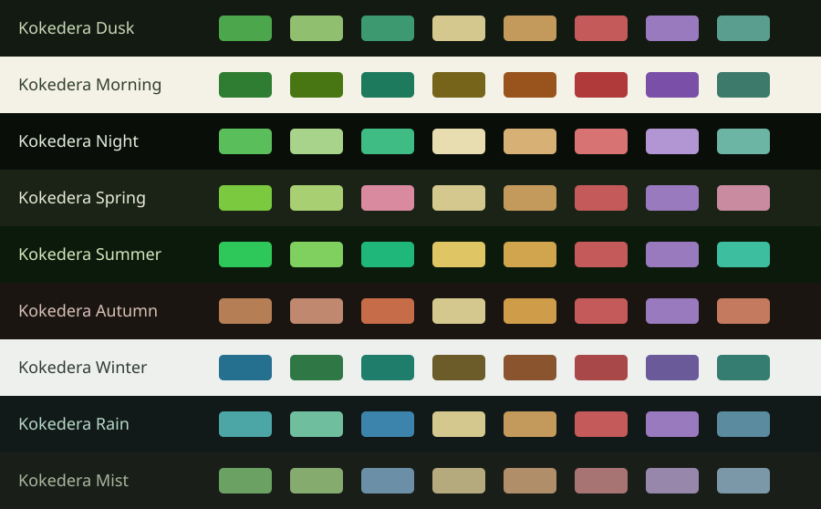

# Kokedera for Notepad++

Nine native Notepad++ XML themes covering built-in lexers, selections, gutters and tabs.

Nine palettes inspired by forest greens, weathered stone, and warm lantern light. Seven dark variants and two light variants, matching the Kokedera themes for VS Code, JetBrains, and Zed.

[Explore Kokedera](https://kokedera.style) · [All ports](https://github.com/cappuccinotogo/kokedera-themes)

## Variants

| Name | Appearance |
| --- | --- |
| Kokedera Dusk | dark |
| Kokedera Morning | light |
| Kokedera Night | dark |
| Kokedera Spring | dark |
| Kokedera Summer | dark |
| Kokedera Autumn | dark |
| Kokedera Winter | light |
| Kokedera Rain | dark |
| Kokedera Mist | dark |

## Installation

Close every Notepad++ window. Copy the XML files from `themes/` to `%AppData%\Notepad++\themes\`. For portable/local configuration, use the `themes\` folder beside `notepad++.exe`. Reopen Notepad++, select **Settings → Style Configurator**, and choose **Kokedera Dusk** or another variant.

Notepad++ 8.9 or newer is recommended because new lexer styles are propagated with the active theme's default colors. Choose the application's Dark Mode separately for the dark variants. Files are UTF-8 without a BOM. Do not import these files as User Defined Languages. `FORMAT-NOTES.md` records lexer coverage and the format source.

## Consistency and maintenance

This folder contains ready-to-use files generated by [kokedera-themes](https://github.com/cappuccinotogo/kokedera-themes). Please open issues and pull requests there. The same palette snapshot supplies every port; terminal ANSI colors and syntax roles come from the existing VS Code themes. Application-specific UI roles are mapped in the central generators.

To change colors or fix a mapping, edit the central source in [kokedera-themes](https://github.com/cappuccinotogo/kokedera-themes) and regenerate. Avoid hand-editing generated files here. `kokedera.json` records the palette and generator hashes, all nine variants, and file checksums. Run `python scripts/verify.py` to check this checkout.

These are direct-install ports. A GitHub release does not imply approval or inclusion in an application's theme store. See the installation notes for application-specific limits.

## Format references

- https://npp-user-manual.org/docs/themes/
- https://npp-user-manual.org/docs/config-files/
- https://github.com/notepad-plus-plus/notepad-plus-plus/blob/master/PowerEditor/src/stylers.model.xml

## License

[MIT](LICENSE). Kokedera by Florian Mühlhans.
